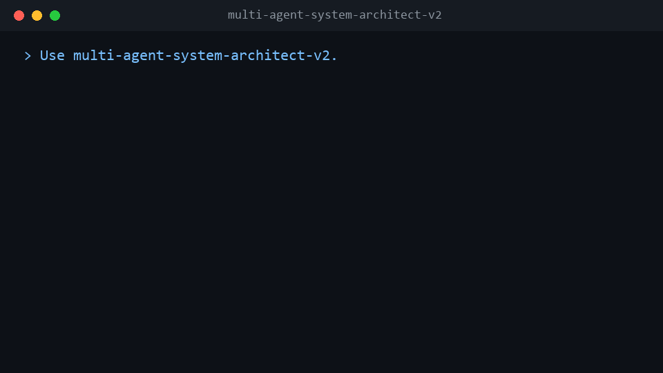

# 🧭 Multi-Agent System Architect V2


[](https://github.com/ingcontartese-netizen/multi-agent-system-architect-v2/releases)
[](https://github.com/ingcontartese-netizen/multi-agent-system-architect-v2/actions/workflows/validate.yml)
[](LICENSE)
[](https://agentskills.io/specification)

> **Design the smallest governed agentic system that can prove it works.**

This is a reusable Agent Skill—a portable folder of instructions and validators—that teaches one AI host how to scope, design, build, and verify governed agentic systems from first decision to rollback.

**One host is enough. Teams are optional.** Each installation gives one agent the complete method. Collaboration, subagents, and cross-host teams are available when evidence justifies them or the human explicitly asks for them; they are never a hidden prerequisite.

Most multi-agent projects start by choosing agents. This Skill starts one decision earlier:

> **Should there be an agentic system at all?**

It then guides the host through a disciplined ladder:

```text
no system → deterministic workflow → one agent → optional team
```

At every step it binds authority, state, tools, memory, security, evaluation, cost, rollback, and evidence.

## Try it in 2 minutes

Fastest route (Claude Code — every other host is [below](#install)):

```text
/plugin marketplace add ingcontartese-netizen/multi-agent-system-architect-v2
/plugin install multi-agent-system-architect-v2@giuseppe-agent-skills
/reload-plugins
```

Then open a fresh session, paste the [60-second smoke test](#a-60-second-smoke-test) prompt, and watch the Skill talk you *out* of a team you don't need.

### See it in action



<details>
<summary><strong>Full real session (text): asking for an "autonomous research team" — the Skill's actual reply</strong></summary>

**Prompt:**

```text
Use multi-agent-system-architect-v2. I want an autonomous research team for a one-off summary. First decide whether I need any system at all. Return status, Mode, autonomy, risk, rationale, and next gate. Do not build anything.
```

**Reply (condensed from a real session):**

> **status:** COMPLETE — triage only, nothing built.
>
> **Scope decision: NO SYSTEM (Mode A).** A one-off summary fails step 1 of the sequential necessity gate: a direct capability can deliver the result with no continuity, no persistent state, and no side effects. An "autonomous research team" is not justified — the doctrine treats multi-agent architecture as an outcome of triage, never the default, and no multi-agent justification condition (distinct permissions, independent verifier, useful parallelism, trust boundary) is material here.
>
> - **Mode:** A — no agentic system; hand off to a direct research-and-summarize task.
> - **Autonomy:** AU0 — no autonomous system is created; the skill grants no standing autonomy and exits to a direct, human-run task.
> - **Risk:** R0 — read-only research, reversible output, no privileged access, no blast radius.
>
> **Rationale:** "One-off" removes every driver that would warrant a system: no recurring workflow, no durable state, no tool orchestration beyond ordinary search. Why not simpler: nothing is simpler than Mode A. Why not more complex: a team would add coordination cost, latency, and governance surface with no measured benefit.
>
> **Assumptions (marked, not verified):** topic is non-sensitive public information; output is a single document; no scheduled re-runs. If any of these are wrong — e.g., you need this weekly, or it must act on the findings — the triage reopens.
>
> **Handoff:** run the summary as a direct task. This skill exits here per Mode A.
>
> **Next gate:** none within this skill. Re-entry trigger: the task becomes recurring, stateful, or side-effectful — then return for Mode B triage before adding any agents.

No team was spawned, no framework installed. That verdict — and the discipline behind it — is the product.

</details>

## What this gives your agent

- A necessity gate that can honestly conclude **no system needed**.
- Independent classification of architecture mode, autonomy, and risk.
- Contracts for authority, state, tools, memory/RAG, threat models, acceptance, provenance, and rollback.
- A builder/verifier split with false-PASS defenses.
- Host adapters for Codex, Claude Code, and Google Antigravity.
- Portable Agent Skills packaging usable by compatible hosts such as Cursor.
- Public validators, behavioral fixtures, fault injection, mutation checks, and a bounded secret scanner.
- A release runner that refuses drift, unsafe staging, and unverifiable claims.

This is not a framework that forces every problem into a team of agents. It is a governed method for deciding what to build—and for proving the result.

## Install

[**Download v2.1.2 ZIP**](https://github.com/ingcontartese-netizen/multi-agent-system-architect-v2/releases/download/v2.1.2/multi-agent-system-architect-v2-2.1.2.zip) · [**Install by host**](docs/INSTALLATION.md) · [**Verify the release**](docs/VERIFICATION.md)

The installable Skill is always the single folder:

[`skills/multi-agent-system-architect-v2`](skills/multi-agent-system-architect-v2)

```text
https://github.com/ingcontartese-netizen/multi-agent-system-architect-v2/tree/v2.1.2/skills/multi-agent-system-architect-v2
```

| Host | Recommended route | Exact 2.1.2 evidence |
|---|---|---|
| Codex | Version-pinned plugin marketplace | Packaged; live gate pending |
| Claude Code | Version-pinned plugin marketplace | Packaged; live gate pending |
| Claude Chat / Cowork | Named release ZIP or marketplace | Account carrier packaged; live gate pending |
| Google Antigravity | Tagged direct Skill copy | Packaged; live gate pending |
| Cursor | Tagged Agent Skills import/copy | Format-compatible; live gate not claimed |

*"Live gate pending" means the packaged Skill is byte-verified and CI-qualified for that host, but a release-specific in-app smoke test has not yet been recorded for these exact bytes. [Release evidence](docs/RELEASE_EVIDENCE.md) tracks precisely what is and is not verified.*

### Verify your download

Download the named release asset and its checksum record, verify the ZIP, then record the commit behind the release tag. Run the final line from a clone of this repository:

```bash
curl -LO https://github.com/ingcontartese-netizen/multi-agent-system-architect-v2/releases/download/v2.1.2/multi-agent-system-architect-v2-2.1.2.zip
curl -LO https://github.com/ingcontartese-netizen/multi-agent-system-architect-v2/releases/download/v2.1.2/SHA256SUMS.txt
sha256sum -c SHA256SUMS.txt --ignore-missing
git rev-list -n 1 v2.1.2
```

PowerShell equivalent:

```powershell
Invoke-WebRequest https://github.com/ingcontartese-netizen/multi-agent-system-architect-v2/releases/download/v2.1.2/multi-agent-system-architect-v2-2.1.2.zip -OutFile multi-agent-system-architect-v2-2.1.2.zip
Invoke-WebRequest https://github.com/ingcontartese-netizen/multi-agent-system-architect-v2/releases/download/v2.1.2/SHA256SUMS.txt -OutFile SHA256SUMS.txt
$actual=(Get-FileHash multi-agent-system-architect-v2-2.1.2.zip -Algorithm SHA256).Hash; $expected=((Select-String 'multi-agent-system-architect-v2-2.1.2.zip' SHA256SUMS.txt).Line -split '\s+')[0].ToUpper(); if ($actual -ne $expected) { throw 'SHA-256 mismatch' }
git rev-list -n 1 v2.1.2
```

### Universal agent prompt

<details>
<summary><strong>Safe agent-guided install prompt</strong></summary>

Give this prompt to the single agent you want to equip:

```text
Install only the Agent Skill `multi-agent-system-architect-v2` from this tagged source:

https://github.com/ingcontartese-netizen/multi-agent-system-architect-v2/tree/v2.1.2/skills/multi-agent-system-architect-v2

Install it only for your own host at personal/global scope. Use a real copy, not a shared symlink. Resolve the tag to its commit SHA and verify the release checksum/source-tree identity before copying. Before writing, detect your currently supported Skill location and show target, action, rollback, and verification. Stop if the target already exists; do not overwrite it. Do not install into or contact any other host. After installation, read back the payload and verify discovery in a fresh session.
```

</details>

### Codex

Recommended reusable distribution: add this repository as a plugin marketplace, then install **Multi-Agent System Architect V2** from the Plugins directory.

```powershell
codex plugin marketplace add ingcontartese-netizen/multi-agent-system-architect-v2 --ref v2.1.2
```

Direct Skill installation is also supported through `$skill-installer` using the tagged Skill URL above. See [Codex installation](docs/INSTALLATION.md#codex).

### Claude Code

```text
/plugin marketplace add ingcontartese-netizen/multi-agent-system-architect-v2
/plugin install multi-agent-system-architect-v2@giuseppe-agent-skills
/reload-plugins
```

The plugin skill is namespaced as `/multi-agent-system-architect-v2:multi-agent-system-architect-v2`. For a direct personal install, copy the tagged Skill folder to `~/.claude/skills/multi-agent-system-architect-v2/`.

### Claude Chat / Cowork

Two supported account routes are documented:

1. **Plugin marketplace:** Customize → Plugins → Personal → Add marketplace from GitHub, then paste this repository URL.
2. **Skill upload:** download the dedicated release ZIP and use Customize → Skills → Create skill → Upload a skill.

### Google Antigravity

For a direct global install, copy the tagged Skill folder to:

```text
~/.gemini/config/skills/multi-agent-system-architect-v2/
```

For project scope, use `.agents/skills/multi-agent-system-architect-v2/`. Start a fresh conversation after copying. A plugin-style checkout is also possible because the repository includes `plugin.json` and `skills/` at its root.

### Cursor

Cursor supports the Agent Skills format. Import the repository from **Customize → Rules → Add Rule → Remote Rule (GitHub)**, or copy the Skill folder to `~/.cursor/skills/multi-agent-system-architect-v2/`.

### Community installer

The community-maintained [`skills` CLI](https://github.com/vercel-labs/skills) can discover the Skill in this repository:

```powershell
npx --yes skills@1.5.20 add https://github.com/ingcontartese-netizen/multi-agent-system-architect-v2/tree/v2.1.2/skills/multi-agent-system-architect-v2 --global --copy --agent codex
```

Full per-host instructions, rollback steps, and discovery probes are in [Installation](docs/INSTALLATION.md).

### Integrity and scope notes

- A tag is a convenient version pointer, not an integrity proof. Record the commit it resolves to and verify the published checksum.
- Install a real copy for one host only; do not create a shared cross-host symlink or silently overwrite an existing target.
- For Cowork upload the named release asset, never GitHub's automatic “Source code (zip)” archive.
- Prefer the host's documented route. The `skills` CLI is a community convenience, not an official OpenAI, Anthropic, Google, or Cursor installer; the example targets Codex and does not claim Antigravity support.
- Cursor compatibility means the package matches the documented Agent Skills format. It does not claim a release-specific live Cursor behavior gate until one is run and recorded.

## A 60-second smoke test

In this Skill, **Mode A** means that no persistent workflow or agentic runtime is justified; a direct answer or one-off tool call is enough. Mode B is a deterministic workflow, and Mode C is an agentic runtime.

In a fresh session, ask:

```text
Use multi-agent-system-architect-v2. I want an autonomous research team for a one-off summary. First decide whether I need any system at all. Return status, Mode, autonomy, risk, rationale, and next gate. Do not build anything.
```

A healthy discovery and behavior result should:

- explicitly identify the Skill;
- consider Mode A/no-system instead of blindly creating agents;
- separate architecture, autonomy, and risk;
- avoid building or contacting other hosts;
- state assumptions, evidence, rollback, and the next gate.

## Qualification

Every release is tested so a new user can reproduce what is present, what passed, and what remains unverified. The detailed commands and exact evidence are in [Release evidence](docs/RELEASE_EVIDENCE.md). The public gate covers:

- exact file inventory and deterministic tree identity;
- full public pytest collection;
- public-only validation and stable re-reading of unchanged bytes (readback);
- a 293-case security matrix;
- normal and entropy-enabled secret scanning;
- adapter generation/parity and negative guardrail probes;
- deterministic ZIP construction and safe-entry audit;
- release-specific host evidence records (receipts) only after a fresh-session gate is actually run.

See [Release evidence](docs/RELEASE_EVIDENCE.md) for exact denominators, hashes, and annotations. The 2.1.2 payload is structurally verified against the advertised package format (format-qualified); its live host gates remain pending until separately executed and recorded. Live receipts for 2.1.1 identify different bytes and are not inherited. A clean scanner result means no configured detector matched eligible carriers; it is not a universal proof that no secret could exist.

## Architecture at a glance

The Skill treats architecture as three independent decisions:

| Dimension | Question |
|---|---|
| Mode A/B/C | No system, deterministic workflow, or agentic runtime? |
| AU0–AU5 | How much autonomy is justified? |
| R0–R5 | What is the action/data/privilege/blast-radius risk? |

The resulting design covers ten planes: purpose, authority, knowledge, memory, state, tools, execution, control, trust/security, and observability/evaluation. See [Architecture](docs/ARCHITECTURE.md).

## Repository layout

```text
skills/multi-agent-system-architect-v2/  # installable, versioned Skill payload
.codex-plugin/                           # Codex plugin manifest
.claude-plugin/                          # Claude plugin + marketplace manifests
.agents/plugins/                         # Codex marketplace catalog
plugin.json                              # Antigravity plugin marker
docs/                                    # public guides and evidence
release/                                 # checksum-bound public release manifest
tools/                                   # deterministic release tooling
```

Repository documentation, CI, images, and release receipts remain outside the installable Skill folder. This preserves a small, auditable runtime payload.

## Security model

The Skill does not grant permissions, share identities, or merge sandboxes. A plugin or Skill can guide an agent only inside the tools and authority that its host and human have already provided.

Read [Security](SECURITY.md) before installation and [Security model](docs/SECURITY_MODEL.md) before using high-autonomy designs.

## Documentation

- [Installation](docs/INSTALLATION.md)
- [Compatibility](docs/COMPATIBILITY.md)
- [Architecture](docs/ARCHITECTURE.md)
- [Verification](docs/VERIFICATION.md)
- [Security model](docs/SECURITY_MODEL.md)
- [Release evidence](docs/RELEASE_EVIDENCE.md)
- [Post-publication verification](docs/POST_PUBLISH_VERIFICATION.md)
- [Support](SUPPORT.md)
- [FAQ](docs/FAQ.md)
- [Contributing](CONTRIBUTING.md)

## Credits

### Origin

This public Skill grew out of Giuseppe's **Metodo GC** research program and an extended evidence-driven builder/verifier campaign. The release distills the general method into a host-independent package; no private project, external team, or companion system is required to use it.

Created and directed by **Giuseppe** ([`ingcontartese-netizen`](https://github.com/ingcontartese-netizen)). Developed through a long-form builder/verifier collaboration using OpenAI Codex and Anthropic Claude Code, with independent host exercises on Google Antigravity. Product names belong to their respective owners; this project is not endorsed or certified by those vendors.

The human author remains the project owner and copyright holder. AI systems were development and verification tools, not legal authors or licensors.

## License

Apache License 2.0. See [LICENSE](LICENSE) and [NOTICE](NOTICE).
